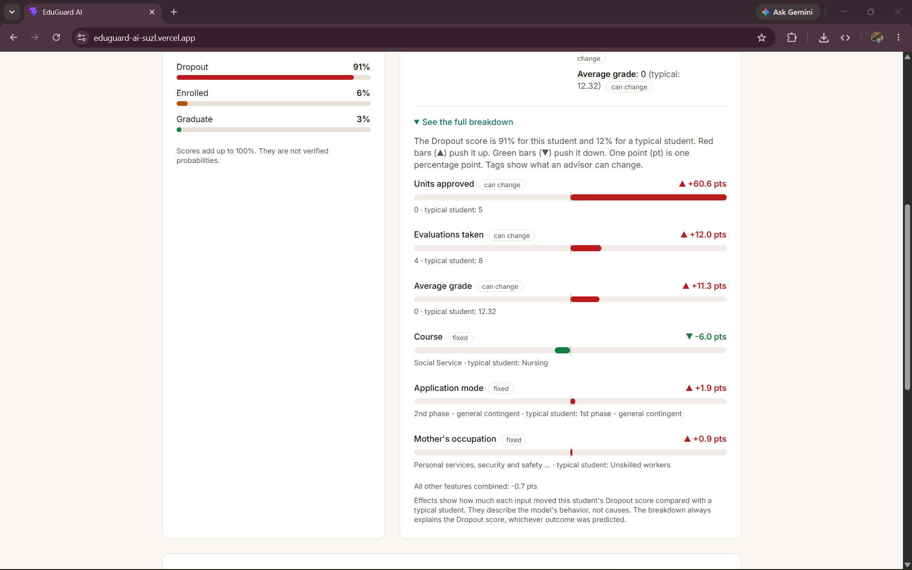
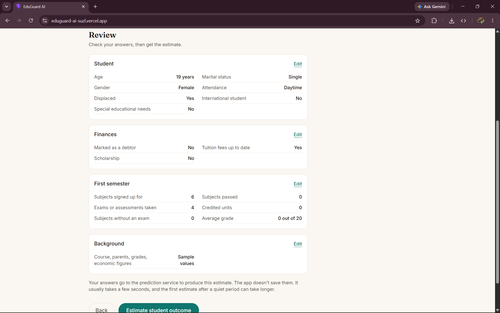
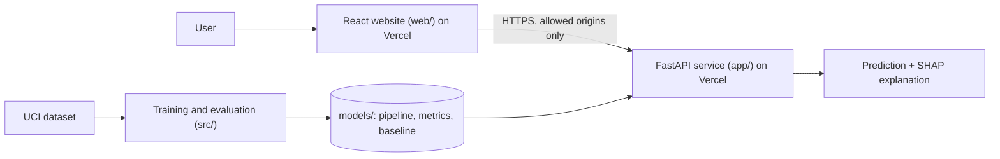

# EduGuard AI: Explainable Student Success Prediction

A machine learning application that estimates whether a student is more likely to
**drop out**, **still be enrolled**, or **graduate**, using information known after
the first semester, and explains each estimate in plain language.

It is built as a learning and portfolio project. It is **not** a validated tool for
real decisions about students.

## Live demo

- **Website:** https://eduguard-ai-suzl.vercel.app
- **API docs:** https://eduguard-ai-eight.vercel.app/docs


## What it includes

- A scikit-learn pipeline (preprocessing + model), compared across 5 algorithms with
  stratified cross-validation and tuned hyperparameters
- A FastAPI service (`/predict`, `/model-info`, `/model-performance`, `/health`) with
  Pydantic validation, per-student SHAP explanations, and automated tests
- A React website (Vite, TypeScript, Tailwind): a guided form, a plain-language result
  page, an explanation chart, an action plan, and a guide to the dataset's codes
- A Streamlit dashboard, kept as a quick local demo and as the place for the
  model-evaluation charts


## Screenshots






## Results

Dataset: 4,424 students, split 80/20 (3,539 train / 885 test), stratified, seed 42.
The test set was used **once**, after the model was chosen.

### Held-out test set (885 students)

| Metric | Score |
|---|---|
| Accuracy | 0.727 |
| Macro F1 | 0.637 |
| Weighted F1 | 0.712 |

| Class | Precision | Recall | F1 | Students |
|---|---|---|---|---|
| Dropout | 0.769 | 0.715 | 0.741 | 284 |
| Enrolled | 0.426 | 0.289 | 0.345 | 159 |
| Graduate | 0.768 | 0.891 | 0.825 | 442 |

The model finds about 7 in 10 dropouts, but **only about 3 in 10 students who stay
enrolled** ("Enrolled" is the hardest class because those students' outcomes are
still open).

### Model comparison (5-fold stratified cross-validation, training data only)

| Model | Accuracy | Macro F1 | Dropout recall |
|---|---|---|---|
| Dummy (always "Graduate") | 0.499 | 0.222 | 0.000 |
| Logistic Regression | 0.748 | 0.659 | 0.757 |
| Decision Tree (depth 5) | 0.717 | 0.605 | 0.718 |
| Random Forest | 0.740 | 0.622 | 0.748 |
| SVM | 0.746 | 0.651 | 0.719 |
| Gradient Boosting | 0.749 | 0.658 | 0.746 |
| **Gradient Boosting (tuned)** | **0.758** | **0.675** | **0.752** |

Several models are within the fold-to-fold spread of each other (about 0.01 to 0.02),
so the differences between the top few are not meaningful. A simple Logistic
Regression keeps up with boosting.

**How the model was chosen.** Missing a dropout is costlier than a false alarm, so the
rule was: require cross-validated Dropout recall of at least 0.74, then pick the best
macro F1. The 0.74 threshold was set after seeing the cross-validation results. The
selected model is Gradient Boosting (learning rate 0.1, depth 3, 200 trees).

## Prediction point and data leakage

The dataset documentation says it includes information known at enrollment plus
academic performance at the end of the first and second semesters. Using
Logistic Regression and cross-validation, the choice of feature set matters a lot:

| Feature set | Features | Accuracy | Macro F1 | Dropout recall |
|---|---|---|---|---|
| A: enrollment only | 24 | 0.650 | 0.552 | 0.601 |
| **B: after semester 1 (used)** | 30 | 0.748 | 0.659 | 0.757 |
| C: after semester 2 | 36 | 0.776 | 0.701 | 0.772 |

**Set B is used.** It captures most of Set C's performance a full semester earlier,
leaving time to help. Second-semester data is excluded because it would not be
available at the chosen prediction point.

**Known limitations of this choice:**
- Much of Set B's strength comes from first-semester results, so the model is better at
  recognizing students who are *already* struggling than at predicting surprises.
- The dataset does not document when "tuition fees up to date" and "debtor" were
  recorded. If they were recorded late, they may leak information about the outcome.
  Removing both features lowered cross-validated accuracy from 0.758 to 0.733 and
  Dropout recall from 0.752 to 0.719, so the model relies on them but does not depend
  on them entirely.

## Explanations

Each prediction includes a SHAP explanation of the **Dropout score**: how much each
input moved the score compared with a "typical student" (most common value of each
categorical feature, median of each numeric feature, from the training set). Effects
add up exactly to the model's score. SHAP's fast tree explainer does not support this
multiclass model, so a model-agnostic permutation explainer is used instead.

Explanations describe the model's behavior, not real-world causes.

## Architecture



Training happens offline. The API loads the saved pipeline once at startup and never
retrains. The website calls the API over HTTPS, and the API only accepts requests from
the website's address.

## Project structure

```
app/            FastAPI service (main, schemas, predictor, explainer)
web/            React website
src/            Pipeline code: features, preprocessing, tuning, evaluation, SHAP
dashboard/      Streamlit app and code tables
models/         Saved pipeline, metrics, and baseline student
reports/        Saved model comparison
scripts/        Exploration and manual-check scripts
tests/          Unit and API tests
examples/       Example API request
```

## Setup

Developed and tested with Python 3.14.6 on Windows. Commands below are for Windows
PowerShell (on macOS or Linux, activate with `source .venv/bin/activate`; this has
not been tested).

```powershell
git clone <your-repo-url>
cd eduguard-ai
python -m venv .venv
.\.venv\Scripts\Activate.ps1
pip install -r requirements-dev.txt
```

## Reproduce the results

```powershell
python src/download_data.py     # downloads the dataset from UCI
python src/compare_models.py    # cross-validated comparison -> reports/model_comparison.json
python src/tune.py              # hyperparameter search (prints every configuration)
python src/evaluate.py          # trains the final model, scores the test set, saves models/
```

All randomness uses seed 42 (`RANDOM_STATE` in `src/data_preprocessing.py`).

## Run the app

Use two terminals, both in the project folder with the environment activated.

```powershell
uvicorn app.main:app
streamlit run dashboard/streamlit_app.py
```

The API runs at http://127.0.0.1:8000 (interactive docs at `/docs`) and the dashboard
at http://localhost:8501.


## Run the website locally

You need Node.js (the LTS version). With the API running (`uvicorn app.main:app`):

```powershell
cd web
npm install
npm run dev
```

The site runs at http://localhost:5173. To point it at a different API, set
`VITE_API_URL` (see `web/.env.example`).

## Deployment

Both parts are deployed on Vercel as separate projects:

| Part | Project settings | Environment variable |
|---|---|---|
| API | Repository root, `main` branch | `ALLOWED_ORIGINS`: the website's address (comma-separated for several) |
| Website | Root directory `web` | `VITE_API_URL`: the API's address (read at build time) |

`web/vercel.json` rewrites every path to `index.html`, so links like `/about` work.
The API's `ALLOWED_ORIGINS` list means browsers on other sites can't call it.


## API example

```powershell
curl.exe -X POST http://127.0.0.1:8000/predict -H "Content-Type: application/json" -d "@examples/student.json"
```

The response has the predicted class, class scores, an explanation, and a disclaimer.
Invalid input (for example `"age_at_enrollment": 5`) returns HTTP 422 with a readable
message.

## Tests

```powershell
python -m pytest -q
```

The suite has 16 tests covering valid and invalid API requests, response structure,
explanation consistency, preprocessing behavior, unseen categories, and split
reproducibility. It needs `models/` to exist (run `src/evaluate.py` first).

## Limitations

- Trained on one Portuguese institution's data; it may not transfer elsewhere.
- Recall for the "Enrolled" class is low (0.289 on the test set).
- Test results come from a single 885-student split, so small differences are noise.
- Gender is an input feature, and the dataset records it as male or female only. In an
  ablation, removing gender and the three economic indicators (on top of removing
  fee and debtor features) changed cross-validated accuracy from 0.733 to 0.730, but no
  fairness audit has been done.
- The economic indicators describe the period, not the student.
- Model scores are not calibrated, verified probabilities.
- The free hosting plan means the first request after a quiet period can be slow.
- The recommendations on the result page are rule-based suggestions, not validated advice.

## Future improvements

- Retrain without gender and the economic indicators, and test for group differences
- Check probability calibration
- Evaluate on a time-based split, if enrollment dates become available
- Add rate limiting to the public API.

## Data and license

Dataset: Realinho, V., Vieira Martins, M., Machado, J., & Baptista, L. (2021).
*Predict Students' Dropout and Academic Success* [Dataset]. UCI Machine Learning
Repository. https://doi.org/10.24432/C5MC89 (CC BY 4.0). Introductory paper: Martins
et al., "Early prediction of student's performance in higher education: a case study",
Trends and Applications in Information Systems and Technologies (2021).

The dataset is not included in this repository. The code is released under the MIT
license (see `LICENSE`).